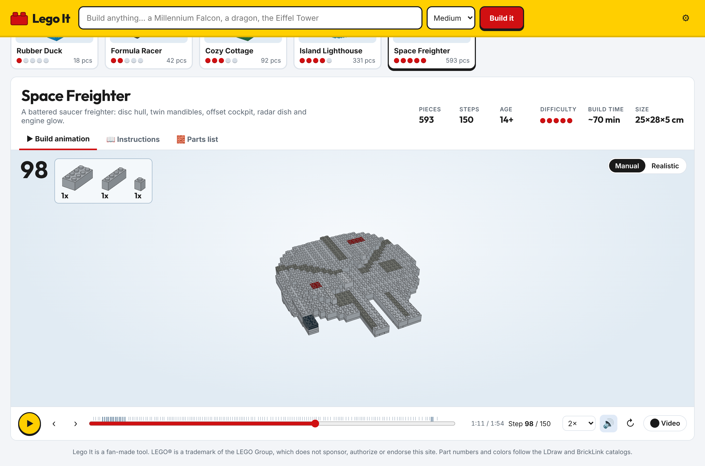
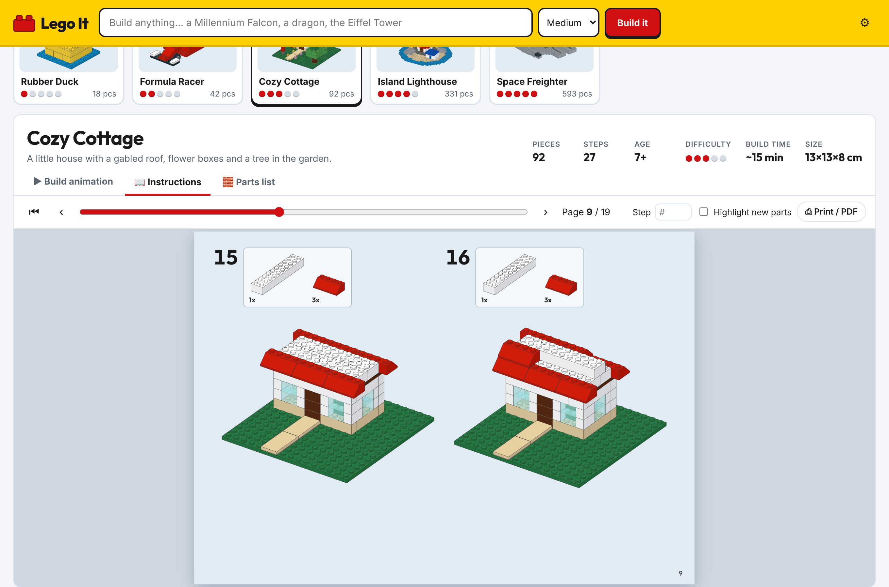
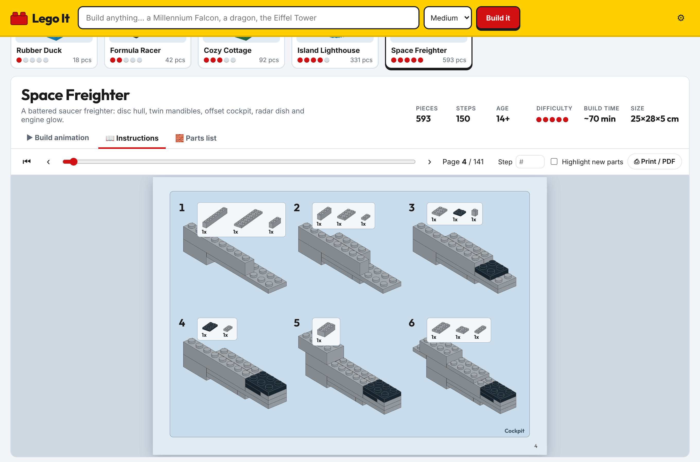
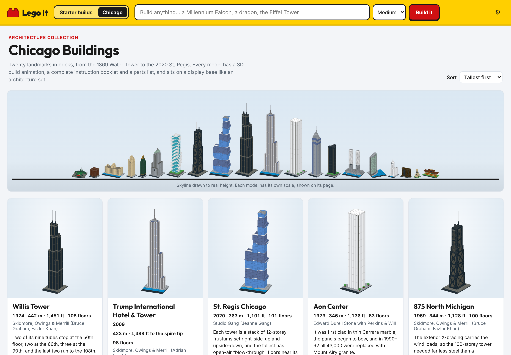

# Lego It

**Live:** https://lego-it.vercel.app/

Turn anything into a brick model you can actually build, with:

1. **Build animation** – the whole model assembles brick by brick in 3D: parts drop in and click into place, sub-assemblies are built on the side and flown in, and the camera follows the model as it grows. Scrub, change speed, step through, hover any brick to identify it, and record the build as a video.
2. **Instructions that look like a real LEGO manual** – cover page, numbered steps with the rounded “parts needed” callout (`2x`), framed sub-assemblies with their own step numbers, attach arrows, “turn the model” icons, bag numbers, a finished-model page and the parts inventory at the back. Print it or save it as a PDF.
3. **Piece overview** – every element with a render, count, part number and color, grouped by color or type. **Order the parts** sends the list to **LEGO Pick a Brick** (a CSV of element IDs, split into uploads of at most 999 pieces), **BrickLink** or **Brick Owl** (a Wanted List copied to the clipboard), opening each shop's import page. Part numbers and element IDs are matched against the Rebrickable catalog; pieces in a colour LEGO never made for that part are ordered in the closest colour that exists, and the page lists them. Exports: **LDraw `.ldr`** (with build steps; opens in BrickLink Studio, LeoCAD, LDView), a **BrickLink Wanted List XML** and **CSV**.
4. **Build anything** – type an idea (“Millennium Falcon”, “a dragon”, “the Eiffel Tower”) and Claude designs it. Needs your own Claude API key (Settings ⚙). Without a key, prompts that match a sample open that sample.

| Build animation | Instruction pages | Sub-assembly page |
|---|---|---|
|  |  |  |

Each model also shows piece count, step count, age, difficulty, estimated build time and real-world size, and has a **Manual** (flat colors with outlines) and **Realistic** (glossy plastic, shadows) render style.

## Chicago Buildings catalog

The site opens on the catalog: 21 Chicago landmarks as detailed display models, each on a black base with a nameplate, with the real story behind the building (year, architect, height, floors, style, location, a fact) and its model scale. A skyline of all of them, drawn to real height, sits above the grid; filter by era or sort by height, age or name. Pick a building and its page starts building it right away, with previous/next to move through the collection and Esc or "All buildings" to go back. Links: `#chicago/willis-tower` opens a building, `#starter/freighter` a starter build.

Catalog pictures are pre-rendered into `public/thumbs/` so the landing page appears instantly. After changing a model, run `npm run dev`, then `npm run thumbs` to refresh them (the app renders live if a picture is missing).



| Building | Year | Pieces | What makes it recognizable |
|---|---|---:|---|
| Willis Tower | 1974 | 804 | Nine bundled tubes stepping back at floors 50, 66 and 90; black frame, bronze glass, twin antennas |
| Trump International Hotel & Tower | 2009 | 622 | Setbacks aligned with the Wrigley Building, Marina City and 330 N. Wabash; spire |
| St. Regis Chicago | 2020 | 685 | Three towers of alternating frustums rising toward the west; blow-through floors |
| Aon Center | 1973 | 1,354 | White chevron piers with recessed windows and notched corners |
| 875 North Michigan (Hancock) | 1969 | 990 | Taper, five tiers of X-bracing, twin antennas |
| Two Prudential Plaza | 1990 | 815 | Chevron setbacks, pyramid turned 45°, spire |
| Aqua | 2009 | 611 | Undulating white balcony slabs over blue glass, green-roofed podium |
| Lake Point Tower | 1968 | 1,242 | Three-lobed plan in dark bronze glass, park on the podium |
| Chicago Board of Trade | 1930 | 1,229 | Art Deco “throne”, copper pyramid, Ceres, the clock over LaSalle Street |
| Marina City | 1964 | 274 | Corncob towers from round plates: spiral garage below, balconies above |
| Carbide & Carbon Building | 1929 | 582 | Dark green shaft, black granite base, gold crown |
| 333 Wacker Drive | 1983 | 1,200 | Convex green-glass curve on the river, gridded city side |
| Tribune Tower | 1925 | 825 | Gothic piers, octagonal crown with buttresses and pinnacles |
| Wrigley Building | 1924 | 767 | White terra cotta, clock tower, sky bridges |
| Merchandise Mart | 1930 | 738 | Two-block Art Deco mass with corner pavilions and central tower |
| Monadnock Building | 1891 | 1,096 | Dark masonry slab, bay windows, flared base and cornice |
| The Rookery | 1888 | 1,035 | Masonry walls around a glass-roofed light court, corbelled cornice |
| Chicago Water Tower | 1869 | 619 | Castellated base, corner turrets, pinnacles, lantern |
| Wrigley Field | 1914 | 824 | Grandstands, ivy wall, bleachers, scoreboard, red marquee |
| Robie House | 1910 | 559 | Roman brick, art-glass bands, cantilevered roofs, central chimney |
| Cloud Gate (The Bean) | 2006 | 810 | Chrome mercury-drop form, the 12-ft arch and omphalos underneath, visitors for scale; mirrors a skyline in the realistic view |

The models are built with `src/chicago/kit.ts`: voxel massing, a facade painter that knows which way each wall faces (for piers, recessed windows, X-braces, bands), layered ground (plazas, the river, a ball field) and direct parts for crowns, spires and round elements. `npx tsx scripts/chicago-stats.ts` checks every model for overlapping parts, and `dev/preview.html#<id>` (or `#all`) renders models from several angles while you work on them.

## Chicago River tour

The **Chicago River** tab (`#river`) is a boat tour through a brick-built downtown: it starts on Lake Michigan outside the breakwater, passes Navy Pier and the harbor lock, runs the Main Stem to Wolf Point, goes up the North Branch to the turning basin at the top of Goose Island, comes back down the North Branch Canal, and follows the South Branch to Ping Tom Park in Chinatown (14.9 km). A short tutorial opens first (tick "Don’t show this next time" to skip it; the ? button brings it back). Tap any building or bridge for its details; **Build it** opens a build page (animation, instructions, parts list) for that building, and landmarks that are in the catalog also link to their detailed model. Drag to look around, pinch or scroll to zoom, jump with the stop chips, the slider or the map.

What is real and what is not:

- **From OpenStreetMap, as mapped:** the shoreline, river and canal, piers and breakwaters, streets, parks and rail yards; the footprint of all 15,372 buildings in the area, rasterised at one stud = 4 m (about 1:500, one plate = 1.6 m); building names and addresses; the position, direction, length and width of all 37 bridges over the route; the route itself, which follows the mapped river centerlines.
- **Heights:** the mapped height where OpenStreetMap has one (nearly every tower, including 3D building parts for Willis Tower, Marina City, the Merchandise Mart and others), otherwise estimated from the mapped floor count, otherwise a default by building type. The details card says which. A few dozen riverfront landmarks were checked by hand (`scripts/river/curated.py`).
- **Bridge and landmark facts** (names, years, bridge types, architects, the stories) are hand-written in `scripts/river/curated.py`.
- **Stylised:** facades are one of four generic brick patterns in an approximate colour, bridges are drawn from a handful of structural types (pony truss, deck truss, double deck, through truss, vertical lift, raised leaf, tied arch), and nothing below street level (Lower Wacker, the Riverwalk steps) is modelled.

Map data © [OpenStreetMap](https://www.openstreetmap.org/copyright) contributors, available under the Open Database License. `public/river/` is a derived database under the same licence. To rebuild it:

```bash
mkdir data && cp scripts/river/waterlines.json data/
python3 scripts/river/fetch_osm.py data     # downloads the map tiles from the OpenStreetMap API
python3 scripts/river/build_data.py data    # needs numpy and Pillow; writes public/river/
```

## Sample builds (least → most complex)

| Model | Pieces | Steps | Highlights |
|---|---:|---:|---|
| Rubber Duck | 18 | 8 | First build: bricks, slopes, tiles |
| Formula Racer | 42 | 13 | Wheels on wheel-holder plates, a driver, rear-wing sub-assembly |
| Cozy Cottage | 92 | 27 | Running-bond walls with windows and a door, gabled roof, tree sub-assembly |
| Island Lighthouse | 331 | 69 | Rocky island, striped tower, lamp-room sub-assembly, 2 bags |
| Space Freighter | 593 | 150 | Falcon-style saucer: mandibles, offset cockpit and radar dish sub-assemblies, 4 bags |

### Ordering data

`src/lego/elements.json` maps every app part and colour to catalog part numbers and LEGO element IDs, and picks the substitute colours. Rebuild it from Rebrickable's free catalog downloads (`parts.csv`, `colors.csv`, `elements.csv` from https://rebrickable.com/downloads/):

```bash
python3 scripts/parts/build_elements.py <folder with the unzipped csv files>
```

## Run it

```bash
npm install
npm run dev        # http://localhost:5173
npm run build      # static site in dist/
npx tsx scripts/stats.ts   # piece/step stats + overlap check for every sample
npm run build:artifact     # build + dist/artifact.html for the claude.ai-hosted page
```

## Deploy to Vercel

The repo is ready for Vercel with no extra settings (`vercel.json`: Vite, `npm ci`, `npm run build`, output `dist/`).

1. Go to https://vercel.com/new and import `willyclayton/lego-it`.
2. Keep the detected settings and click **Deploy**.
3. Every push redeploys. Pushes to the production branch (usually `main`) update the live site; other branches get preview URLs. To go live from a different branch, change it under *Project → Settings → Git → Production Branch*.

On Vercel, "Build anything" uses the visitor's own Claude API key (entered in Settings, kept in their browser). The samples, animation, instructions, exports and print work without any key.

### Hosted vs. self-hosted

The same build runs in both places and adapts at runtime (`src/host.ts`):

| | Hosted on claude.ai | Local / any static host |
|---|---|---|
| Build anything | Viewer's own Claude account (asked to allow it once); no key | Your Claude API key (Settings) |
| Exports & video | Save prompt; `.ldr` and `.xml` arrive zipped | Direct downloads |
| Print / PDF | Not available (the host blocks printing) | Available |

## How it works

```
idea ─► Claude (optional) ─► shape program ─┐
                     sample shape programs ─┼─► voxels ─► bricks ─► steps ─► 3D animation
                       hand-placed samples ─┘   (1 stud × 1 plate)          instruction book
                                                                            parts list / exports
```

- **Shape programs** (`src/lego/shapes.ts`): a model is an ordered list of solid shapes (box, ellipsoid, cylinder, wedge, torus) that are added, subtracted or painted, in studs on every axis so round things stay round. Claude writes these as JSON (structured outputs), and the larger samples use the same format, so both paths share one pipeline.
- **Voxels → bricks** (`src/lego/voxel.ts`): cells are 1 stud × 1 plate. Uniform 3-plate columns become bricks, the rest plates (or tiles). Packing is greedy largest-part-first with the preferred orientation alternating every course and a bonus for bridging seams below, which gives a proper running bond. A slope pass turns one-brick stair-steps into 45° slopes.
- **Steps** (`src/lego/steps.ts`): bottom-up, every part must rest on or hang from something already placed, back-to-front from the camera so new parts aren't hidden, compact clusters, limited parts and types per step. Sub-assemblies are sequenced separately and attached as one step. Rotations are suggested when new parts would be occluded; big builds are split into numbered bags.
- **Rendering** (`src/render/`): procedural part geometry (no external part library) with LDraw-style hard edges plus *conditional* lines that only draw where a curved surface forms a silhouette (stud sides, round bricks, wheels). The whole model is merged into four draw calls; a per-brick float texture holds visibility, offset and highlight, so animating any brick is a texel write. Outlines fade toward the part color when bricks get small on screen.
- **Animation** (`src/render/timeline.ts`, `player.ts`): every brick's state is a pure function of time, so scrubbing, speed changes and video export are trivial. Drop from 4 brick heights, ease-out-cubic, a white flash on landing, a synthesized plastic click (Web Audio, no assets), side-bay sub-assemblies, and an auto camera that reframes as the model grows and orbits slowly.
- **Instruction pages** (`src/ui/Instructions.tsx`, `src/render/pageRenderer.ts`): orthographic renders at a 30° elevation 3/4 view, laid out 1–4 steps per page depending on how big the model is at that point; sub-assemblies get a 6-up framed page.

### Build anything (Claude)

`src/ai/generate.ts` calls `claude-opus-5-5` from the browser with the official TypeScript SDK (`dangerouslyAllowBrowser`), streaming, effort `high`, a JSON-schema structured output for the shape program, and server-side refusal fallback (`fallbacks: "default"`). The key is entered in Settings, kept in memory (or in `localStorage` only if you tick *Remember*), and only ever sent to `api.anthropic.com`. Use a key with a spending limit; one design typically costs a few tens of cents. The SDK is code-split so it only downloads when you generate.

## Project layout

```
src/lego/      parts catalog, colors, voxel grid + brick converter, shape programs,
               step generator, inventory, LDraw/BrickLink/CSV export
src/render/    part geometry, merged brick mesh + shaders, viewer, page renderer,
               animation timeline, playback engine
src/river/     the river tour: world loader, brick-city mesher and shaders, bridges, boat, picking
src/samples/   the five built-in models
src/ai/        Claude-powered generation
src/ui/        React app: build player, instruction book, parts list
docs/          research notes behind the design
```

## Notes

- Research behind the visual style, animation timing, part geometry and generation approach is summarized in [docs/RESEARCH.md](docs/RESEARCH.md).
- Lego It is a fan-made tool. LEGO® is a trademark of the LEGO Group, which does not sponsor, authorize or endorse this project. No LEGO logos are used and studs are rendered plain. Part numbers and colors follow the LDraw and BrickLink catalogs.
